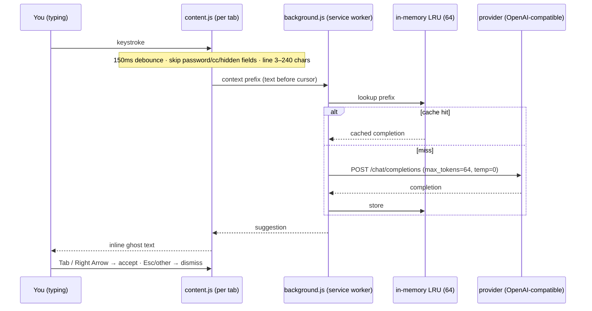

# GhostTyper

> Copilot-style inline AI writing suggestions in any text field — Tab or Right Arrow to accept. 100% client-side, no backend, no telemetry.

[](./LICENSE)
[](https://github.com/chirag127/ghosttyper-bs-ext/stargazers)
[](https://github.com/chirag127/ghosttyper-bs-ext/commits)
[](https://github.com/chirag127/ghosttyper-bs-ext/releases/latest)
[](https://developer.chrome.com/docs/extensions/mv3/intro/)

**Live site:** https://ghosttyper-bs-ext.oriz.in · **GHP landing:** https://chirag127.github.io/ghosttyper-bs-ext/ · **Repo:** https://github.com/chirag127/ghosttyper-bs-ext

⭐ If this is useful, please star the repo — it helps others find it.

As you type in Gmail, Notion, Twitter, web forms — anywhere — GhostTyper fetches a short AI completion for the text before your cursor and renders it inline as greyed-out ghost text. Keep typing to dismiss; press **Tab** or **Right Arrow** to accept instantly. No account, no sign-up; works immediately with the zero-config default provider.

## Request lifecycle



## Features

- **Inline ghost text everywhere** — `<input>` / `<textarea>` via a mirror overlay; `contentEditable` via a Selection/Range ghost span.
- **7 providers, all free-tier** — **Pollinations** (default, no key), Groq, Cerebras, Google Gemini, OpenRouter, Mistral, and any OpenAI-compatible **Custom** endpoint.
- **Copilot-tier UX** — typing-as-suggested (matching keystrokes reveal the remainder with no new call), 64-entry LRU cache, silent-disable after 3 consecutive provider errors, and min/max line guards.
- **Privacy by construction** — 100% client-side; text goes browser → your chosen provider, never through a GhostTyper server (none exists).
- **Sensitive fields always excluded** — passwords, credit-card fields (`autocomplete=cc-*`), hidden inputs, and name/id matching cc patterns are never read or sent.

## Tech stack

Manifest V3 · vanilla JS ES modules · content script + module service worker · `chrome.storage` for settings · OpenAI-compatible `/chat/completions` (`max_tokens=64`, `temperature=0`) · `node --test` for tests. No build step, no framework.

## Repo structure

```
extension/
  manifest.json        # MV3 — permissions: storage, activeTab, scripting
  js/
    content.js         # monitors text fields, renders ghost text
    background.js      # service worker: cache + provider calls
    ai-providers.js    # 7 provider adapters
    popup.js · settings.js · utils.js
  css/ · assets/
  popup.html · settings.html
icons/ · docs/ · tests/
```

## Install

1. Download [ghosttyper.zip](https://github.com/chirag127/ghosttyper-bs-ext/releases/latest) from the latest release and unzip.
2. Open `chrome://extensions` (Chrome / Edge / Brave / Arc).
3. Enable **Developer mode** (top right).
4. **Load unpacked** → select the `extension/` folder.

Works immediately with the Pollinations default — no key needed.

## Configuration

Extension settings only (popup → **Open Settings**); stored in `chrome.storage`. No env vars, no secrets in repo.

| Setting | Purpose |
| :--- | :--- |
| Provider | Which AI provider to use (default Pollinations). |
| API Key | Provider key (not needed for Pollinations); stays in browser storage only. |
| Model | Override the provider's default model. |
| Custom Base URL | Endpoint for the Custom (OpenAI-compatible) provider. |
| Trigger Delay | Debounce before fetching (default 150ms). |
| Presentation Mode | Inline / Popup / Panel. |
| Blocked Sites | Domains where suggestions are disabled. |

## Keyboard shortcuts

| Key | Action |
| :--- | :--- |
| **Tab** | Accept suggestion |
| **Right Arrow** | Accept (fallback when Tab is remapped) |
| **Esc** | Dismiss |
| any other key | Keep typing (dismisses) |

## Security note

No secrets in repo. Everything runs client-side; provider API keys live only in `chrome.storage` in your browser. Password / credit-card / hidden fields are hard-excluded from reads. See the [Privacy Policy](https://ghosttyper-bs-ext.oriz.in/privacy.html).

## Part of the oriz family

One of ~80 sites and tools in the [oriz](https://blog.oriz.in) family by Chirag Singhal — the landing site runs **$0 on the Cloudflare free tier**; the extension itself is fully client-side. Siblings: [envpact-vscode-vsc-ext](https://github.com/chirag127/envpact-vscode-vsc-ext) (client-side VS Code tooling) · [omnijournal](https://github.com/chirag127/omnijournal) (bring-your-own-key AI PKM).

## Contributing

```bash
git clone https://github.com/chirag127/ghosttyper-bs-ext
# load extension/ unpacked in Chrome for development
node --test tests/
```

PRs welcome; open an issue first for large changes. Conventional commits are the changelog.

## Status

Stable — v2.0.0, released.

## License

MIT © Chirag Singhal — chirag@oriz.in · see [LICENSE](./LICENSE).
